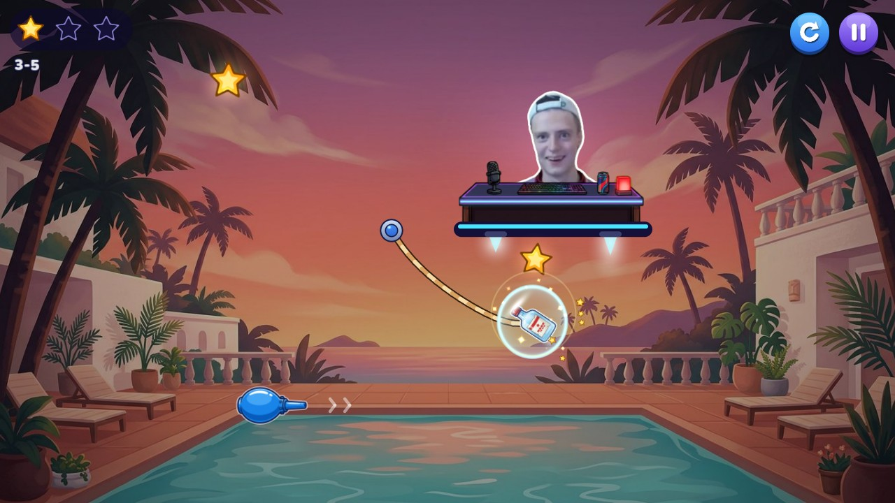
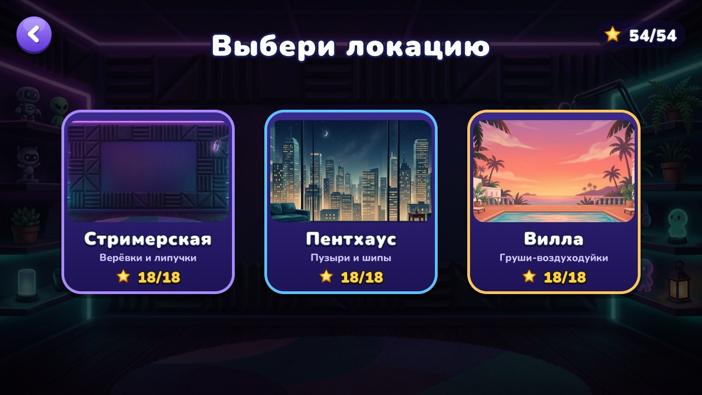

  
  &nbsp;&nbsp;
  

# Мел-Ням

**Перережь верёвку — накорми Мела!**

Головоломка в духе Cut the Rope. На верёвке висит бутылочка, внизу ждёт Мел. Режь верёвки, лопай пузыри,
дуй грушами и собери по дороге три звезды. Мел реагирует вживую: радуется, скучает, кричит «О май гад!» и «Ам-ам-ам!».

- 18 уровней в трёх локациях
- настоящие видеореакции и голос Мела
- работает в браузере и на Windows
- бесплатно, без рекламы и без установки

Сайт игры: **https://timofeybahvalov-cell.github.io/mel-nyam/**

## Как начать играть

Игра во всех версиях одинаковая. Выбери, как удобнее:

| Версия | Скачивать | Интернет | Где работает |
|---|---|---|---|
| В браузере | не нужно | нужен | компьютер, планшет, телефон |
| `MelNyam.exe` | 4,4 МБ | не нужен | Windows |
| `MelNyam.html` | 6,3 МБ | не нужен | Windows, Mac, Linux |

### Способ 1. Сразу в браузере — ничего не надо скачивать

1. Нажми зелёную кнопку **«Играть в браузере»** вверху страницы.
2. Подожди несколько секунд, пока игра загрузится.
3. Нажми **«Играть»**. Звук появится после первого клика — так устроены браузеры.

То же самое можно сделать с сайта игры: открой https://timofeybahvalov-cell.github.io/mel-nyam/ и нажми **«Играть сейчас»**.

Так можно играть на компьютере и ноутбуке с любой системой. На планшете и телефоне игра тоже запускается — поверни экран горизонтально.

### Способ 2. Скачать на компьютер с Windows

1. Нажми синюю кнопку **«Скачать для Windows»** вверху страницы. Скачается один файл `MelNyam.exe` (4,4 МБ).
2. Если браузер спросит, сохранять ли файл, или напишет, что такой файл «редко скачивают», выбери **«Сохранить»**.
3. Открой папку **«Загрузки»** и дважды кликни по `MelNyam.exe`.
4. Может появиться синее окно **«Система Windows защитила ваш компьютер»**. Нажми в нём **«Подробнее»**, а потом **«Выполнить в любом случае»**.
5. Игра запущена. Устанавливать ничего не нужно.

> Синее окно появляется у всех программ, у которых нет платной цифровой подписи. У этой игры её нет.

### Способ 3. Браузерная версия, которая работает без интернета

1. Нажми фиолетовую кнопку **«Скачать архивом»**. Скачается архив `mel-nyam-main.zip` со всеми файлами игры.
2. Открой папку **«Загрузки»**, нажми по архиву правой кнопкой мыши и выбери **«Извлечь всё»**.
3. Открой получившуюся папку и дважды кликни по `MelNyam.html`. Игра откроется в браузере, интернет ей больше не нужен.

> Можно проще: на [сайте игры](https://timofeybahvalov-cell.github.io/mel-nyam/) есть кнопка «Скачать MelNyam.html». Она скачивает этот файл одним кликом, без архива.

## Обзор игры

В каждом уровне задача одна: доставить бутылочку Мелу. По дороге стоит собрать три звезды — за звёзды открываются новые локации.
Любой уровень можно переигрывать сколько угодно раз.

### Стримерская — верёвки и липучки

Первые шесть уровней учат главному: резать верёвку в нужный момент. Бутылка раскачивается, и от момента зависит, куда она полетит.
Липучки — точки с пунктирным кругом — сами цепляют бутылку новой верёвкой, когда она залетает в круг. Локация открыта сразу.

### Пентхаус — пузыри и шипы

Пузырь подхватывает бутылку и несёт её вверх. Клик по пузырю — и он лопается. На шипах бутылка разбивается, и уровень начинается заново.
Чтобы открыть локацию, нужно 8 звёзд.

### Вилла — груши-воздуходуйки

Клик по груше — и струя воздуха толкает бутылку в сторону. Грушей можно раскачать бутылку на верёвке или подогнать пузырь к нужному месту.
Чтобы открыть локацию, нужно 20 звёзд.

### Мел реагирует на всё

Мел сидит за столом и следит за бутылкой. Когда она рядом, он кричит «Ам-ам-ам!», на третьей звезде — «О май гад!»,
а после прохождения на три звезды смеётся. Если бутылка улетела мимо, он расстраивается.

### Меню и выбор локации

   

## Управление

| Что сделать | Как |
|---|---|
| Перерезать верёвку | провести по ней мышкой с зажатой кнопкой или пальцем |
| Лопнуть пузырь | кликнуть по пузырю |
| Дунуть грушей | кликнуть по груше |
| Пауза | Esc |
| Начать уровень заново | R |
| Следующий уровень | Enter |
| Включить или выключить звук | M |
| Полный экран | F |

Не получается уровень? Нажми паузу и выбери **«Показать решение»** — игра сама пройдёт его на три звезды.

## Частые вопросы

**Это вирус?** 
Нет. Игра ничего не устанавливает, не выходит в интернет и не просит никаких разрешений.
Исходный код лежит здесь же, в файле `source_code.zip`: любой может его прочитать и собрать игру сам.

**Windows или браузер ругается на файл. Это нормально?** 
Да. Так бывает с новыми программами без платной цифровой подписи. Как запустить игру, написано выше в способе 2.

**В браузере нет звука.** 
Кликни по игре один раз. Проверь, что звук не выключен на вкладке и в меню игры (кнопка с динамиком).

**Где хранится прогресс?** 
В браузерной версии — в памяти браузера: если почистить данные сайта, прогресс пропадёт.
В версии для Windows — в файле `%APPDATA%\MelNyam\save.dat`.

**Файл `MelNyam.exe` не запускается.** 
Версия для Windows рассчитана на 64-разрядную систему. Если она не запускается, играй в браузере: игра там точно такая же.

**Игра тормозит.** 
Закрой лишние вкладки и программы. Если не помогло, уменьши окно игры: чем меньше картинка, тем легче компьютеру.

**У меня Mac, Linux или телефон.** 
Играй в браузере — это способ 1.

**Нашёл ошибку или придумал уровень.** 
Напиши во вкладке [Issues](../../issues).

## Понравилась игра?

Поставь проекту звезду — кнопка **Star** вверху страницы. Так игру увидит больше людей.

## Что лежит в этом проекте

| Файл | Что это |
|---|---|
| `MelNyam.exe` | игра для Windows |
| `MelNyam.html` | игра для браузера, один файл |
| `index.html` | страница сайта игры |
| `source_code.zip` | исходный код игры и скрипт сборки |
| `pic_*` | картинки для этой страницы и для сайта |

## Для тех, кто разбирается

Игра написана на C на собственном движке: программный рендер, своя физика верёвок, свой звуковой микшер.
Один и тот же код собирается в `MelNyam.exe` (mingw-w64) и в `MelNyam.html` (clang, WebAssembly).

## Про права

Это неофициальная фан-пародия. Игра бесплатная, в ней нет рекламы и покупок, автор не связан с Mellstroy.
Видео и голос взяты из открытых источников, права на них принадлежат их владельцам.
Если вы правообладатель и хотите, чтобы материалы убрали, напишите в [Issues](../../issues) — их удалят.
