

  <a href="https://timofeybahvalov-cell.github.io/mel-nyam/MelNyam.html">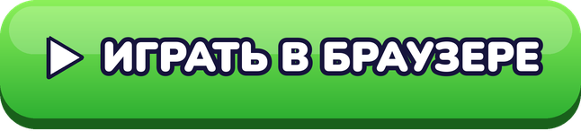</a>
  &nbsp;&nbsp;
  
  &nbsp;&nbsp;
  <a href="MelNyam.apk?raw=true">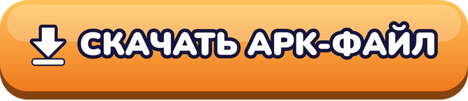</a>

# Мел-Ням

**Перережь верёвку — накорми Мела!**

Головоломка в духе Cut the Rope. На верёвке висит бутылочка, внизу ждёт Мел. Режь верёвки, лопай пузыри,
дуй грушами и собери по дороге три звезды. Мел реагирует вживую: здоровается, торопит, краснеет от злости и кричит «О май гад!».

- 60 уровней в десяти локациях, в каждой локации своя механика
- экзамен на Арене: все механики сразу, десять звёзд, никаких подсказок
- таблица рекордов для каждого уровня: сто лучших по времени, записи прохождений можно смотреть
- редактор уровней: собери свой уровень и опубликуй его для всех
- настоящие видеореакции и голос Мела
- работает в браузере, на Windows и на Android
- бесплатно и без рекламы

Сайт игры: **https://timofeybahvalov-cell.github.io/mel-nyam/**

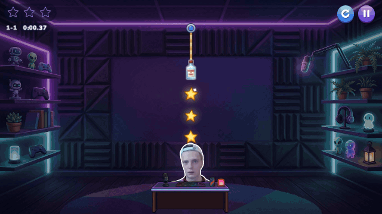

## Как начать играть

Игра во всех версиях одинаковая. Выбери, как удобнее:

| Версия | Скачивать | Интернет | Где работает |
|---|---|---|---|
| В браузере | не нужно | нужен | компьютер, планшет, телефон |
| `MelNyam.exe` | 6,6 МБ | не нужен | Windows |
| `MelNyam.apk` | 6,3 МБ | не нужен | телефон и планшет с Android 7 и новее |
| `MelNyam.html` | 9,7 МБ | не нужен | Windows, Mac, Linux |

Рекорды и уровни других игроков работают с интернетом в любой версии.

### Способ 1. Сразу в браузере — ничего не надо скачивать

1. Нажми зелёную кнопку **«Играть в браузере»** вверху страницы.
2. Подожди несколько секунд, пока игра загрузится.
3. Нажми **«Играть»**. Звук появится после первого клика — так устроены браузеры.

То же самое можно сделать с сайта игры: открой https://timofeybahvalov-cell.github.io/mel-nyam/ и нажми **«Играть сейчас»**.

Так можно играть на компьютере и ноутбуке с любой системой. На планшете и телефоне игра тоже запускается — поверни экран горизонтально.

### Способ 2. Скачать на компьютер с Windows

1. Нажми синюю кнопку **«Скачать для Windows»** вверху страницы. Скачается один файл `MelNyam.exe` (6,6 МБ).
2. Если браузер спросит, сохранять ли файл, или напишет, что такой файл «редко скачивают», выбери **«Сохранить»**.
3. Открой папку **«Загрузки»** и дважды кликни по `MelNyam.exe`.
4. Может появиться синее окно **«Система Windows защитила ваш компьютер»**. Нажми в нём **«Подробнее»**, а потом **«Выполнить в любом случае»**.
5. Игра запущена. Устанавливать ничего не нужно.

> Синее окно появляется у всех программ, у которых нет платной цифровой подписи. У этой игры её нет.

### Способ 3. Установить на телефон с Android

1. Открой эту страницу или [сайт игры](https://timofeybahvalov-cell.github.io/mel-nyam/) на телефоне и нажми оранжевую кнопку **«Скачать APK-файл»**.
   Скачается один файл `MelNyam.apk` (6,3 МБ).
2. Если браузер предупредит, что файл может быть опасным, подтверди скачивание.
3. Когда файл скачается, нажми **«Открыть»**. Не успел — найди `MelNyam.apk` в папке **«Загрузки»**.
4. Телефон скажет, что установка из этого источника запрещена. Нажми **«Настройки»**, включи
   **«Разрешить установку из этого источника»** и вернись назад.
5. Нажми **«Установить»**. Если Play Защита спросит про неизвестное приложение, выбери **«Всё равно установить»**
   или **«Проверить приложение»**.
6. На рабочем столе или в списке приложений появится значок **«Мел-Ням 0.2»**. Запускай игру с него.
   Если значка нет на рабочем столе, зажми его в списке приложений и перетащи туда.

> Нужен Android 7 или новее. Предупреждения появляются у всех приложений, которых нет в Google Play. У игры одно разрешение: доступ в интернет.
> Чтобы обновить игру, скачай новый APK и установи его поверх старого: прогресс сохранится. На iPhone APK не работает — там играй в браузере.

### Способ 4. Браузерная версия, которая работает без интернета

1. Нажми фиолетовую кнопку **«Скачать архивом»**. Скачается архив `mel-nyam-main.zip` со всеми файлами игры.
2. Открой папку **«Загрузки»**, нажми по архиву правой кнопкой мыши и выбери **«Извлечь всё»**.
3. Открой получившуюся папку и дважды кликни по `MelNyam.html`. Игра откроется в браузере, интернет ей больше не нужен.

> Можно проще: на [сайте игры](https://timofeybahvalov-cell.github.io/mel-nyam/) есть кнопка «Скачать MelNyam.html». Она скачивает этот файл одним кликом, без архива.

## Обзор игры

В каждом уровне задача одна: доставить бутылочку Мелу. По дороге стоит собрать три звезды — за звёзды открываются новые локации.
Любой уровень можно переигрывать сколько угодно раз.

### Десять локаций

В каждой локации шесть уровней и одна новая механика. Локации открываются за звёзды.

| № | Локация | Что нового | Сколько звёзд нужно |
|---|---|---|---|
| 1 | Стримерская | верёвки и липучки: липучка сама цепляет бутылку, когда та залетает в пунктирный круг | открыта сразу |
| 2 | Пентхаус | пузыри несут бутылку вверх, на шипах она разбивается | 8 |
| 3 | Вилла | груши-воздуходуйки толкают бутылку струёй воздуха | 20 |
| 4 | Спортзал | батуты подбрасывают бутылку | 34 |
| 5 | Гараж | рельсы: гвоздь с верёвкой можно двигать | 48 |
| 6 | Самолёт | кнопки гравитации: всё падает вверх | 62 |
| 7 | Клуб | лазеры: бутылка сгорает, если задеть луч | 76 |
| 8 | Яхта | порталы переносят бутылку в другое место | 90 |
| 9 | Остров | воришки утаскивают бутылку, если долго ждать | 104 |
| 10 | Арена | экзамен: все механики сразу | 120 |

  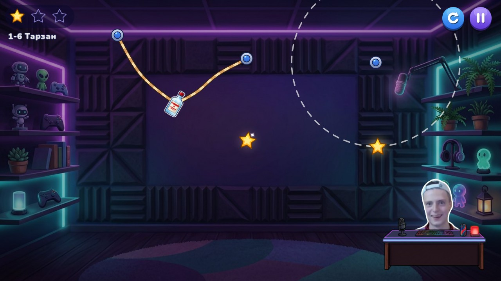 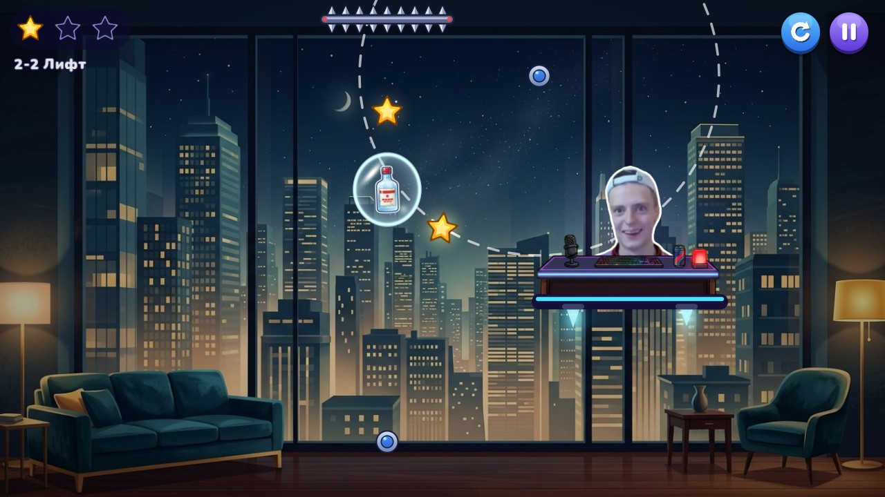

  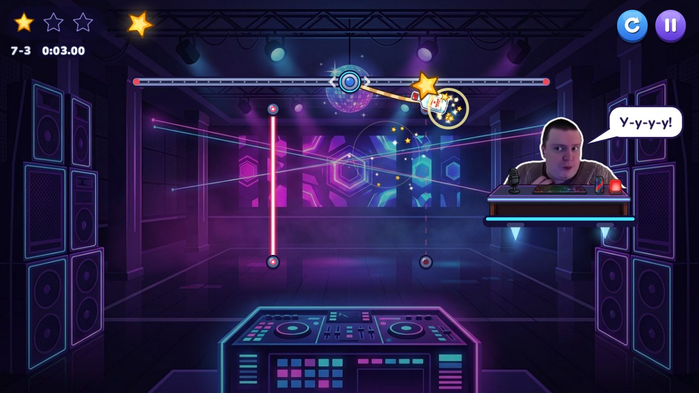 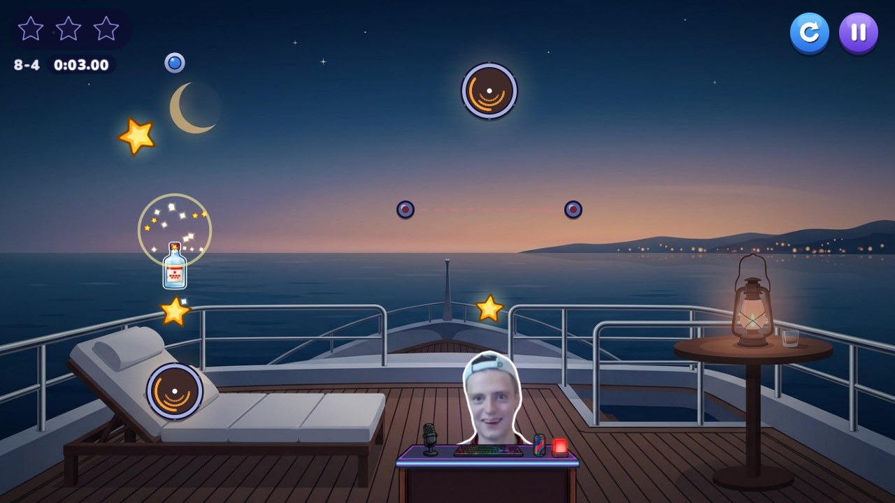

### Экзамен на Арене

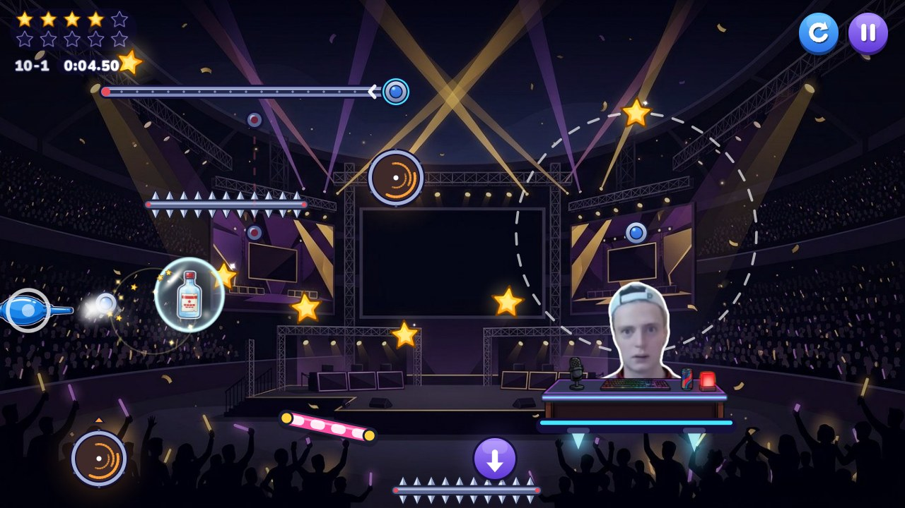

Последняя локация — экзамен. В каждом из шести уровней собраны все механики и лежит десять звёзд.
Подсказок нет, кнопка «Показать решение» не работает: порядок действий нужно найти самому, а счёт идёт на доли секунды.

### Рекорды

У каждого уровня есть своя таблица рекордов: сто лучших игроков. Выше стоит тот, кто собрал больше звёзд, а при равных звёздах — тот, кто быстрее.
Время одной попытки идёт в углу экрана. После первой победы игра спросит ник и сама отправит результат.

Рядом с каждым рекордом есть кнопка просмотра: игра покажет запись этого прохождения. Смотреть чужие записи можно только на уровнях,
которые ты уже прошёл сам. Таблица открывается из главного меню кнопкой **«Рекорды»**.

### Редактор уровней

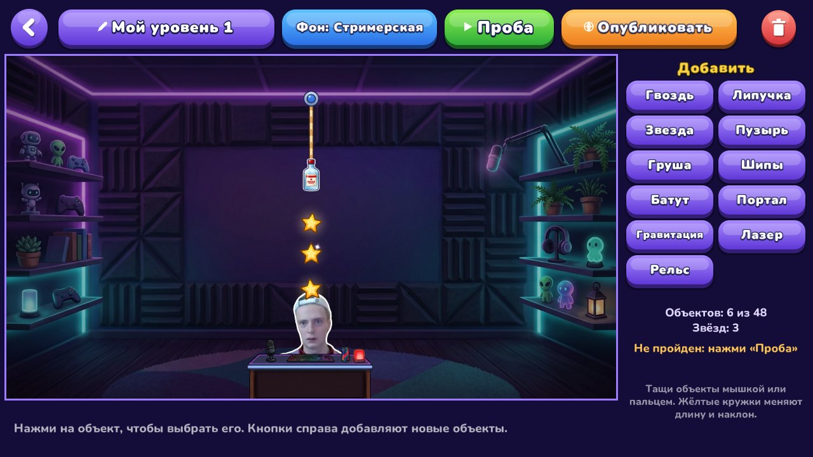

Кнопка **«Редактор»** в главном меню. Добавляй детали кнопками справа, перетаскивай их мышкой или пальцем, меняй длину верёвок и наклон.
Кнопка **«Проба»** запускает уровень. Опубликовать можно только уровень, который ты прошёл сам: так игра проверяет, что он проходим.
Опубликованные уровни лежат во вкладке **«Уровни игроков»**, у каждого своя таблица рекордов.

### Мел реагирует на всё

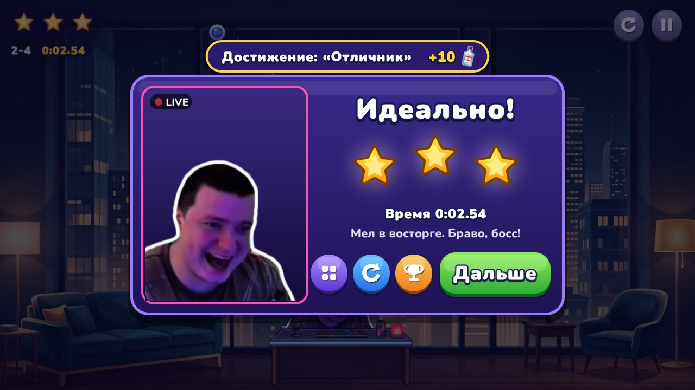

Мел сидит за столом и следит за бутылкой. На первом уровне после запуска игры он здоровается, а когда бутылка рядом, кричит «Дай его!».
Каждая разбитая бутылка злит его сильнее: он краснеет и наконец выдаёт «Я уже красный! Культурно уже не получится!».
Если долго думать, он торопит: «Быстрее! Быстрее!!!». А если много раз ошибиться на сложном уровне, вскакивает и кричит.
Ругательства в игре закрыты писком.

### Меню и выбор локации

  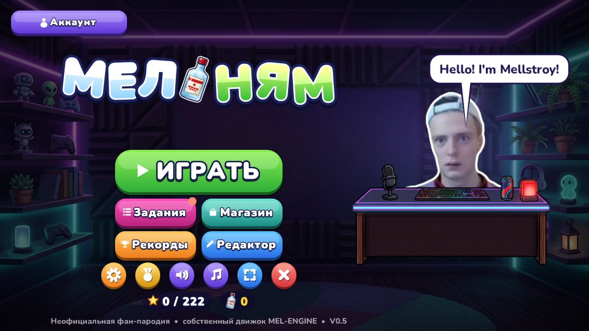 

## Управление

| Что сделать | Как |
|---|---|
| Перерезать верёвку | провести по ней мышкой с зажатой кнопкой или пальцем |
| Лопнуть пузырь | кликнуть по пузырю |
| Дунуть грушей | кликнуть по груше |
| Перевернуть гравитацию | кликнуть по кнопке со стрелкой |
| Сдвинуть гвоздь по рельсу | потянуть его мышкой или пальцем |
| Пауза | Esc |
| Начать уровень заново | R |
| Следующий уровень | Enter |
| Включить или выключить звук | M |
| Полный экран | F |

Не получается уровень? Нажми паузу и выбери **«Показать решение»** — игра сама пройдёт его на три звезды. На Арене решений нет.

## Частые вопросы

**Это вирус?** 
Нет. Версии для компьютера ничего не устанавливают и не просят никаких разрешений. Версия для Android — обычное приложение
с одним разрешением: доступ в интернет. В интернет игра выходит только за таблицей рекордов
и уровнями других игроков. Исходный код лежит здесь же, в файле `source_code.zip`: любой может его прочитать и собрать игру сам.

**Как попасть в таблицу рекордов?** 
Пройди уровень. После первой победы игра спросит ник, и твой результат сам уйдёт в таблицу.

**Написано «Онлайн-таблица пока не подключена».** 
Общая таблица сейчас недоступна или нет интернета. Твои рекорды сохраняются на устройстве и уйдут в таблицу, когда она заработает.

**Windows, Android или браузер ругается на файл. Это нормально?** 
Да. Так бывает с новыми программами, которых нет в магазинах приложений и у которых нет платной цифровой подписи.
Как запустить игру, написано выше: для Windows — в способе 2, для Android — в способе 3.

**APK не устанавливается.** 
Проверь версию системы: нужен Android 7 или новее. Освободи место на телефоне: когда память почти заполнена, Android не ставит новые приложения.
Если телефон всё равно пишет «Приложение не установлено», удали старую версию игры и установи новую заново — прогресс при этом сотрётся.

**В браузере нет звука.** 
Кликни по игре один раз. Проверь, что звук не выключен на вкладке и в меню игры (кнопка с динамиком).

**Где хранится прогресс?** 
В браузерной версии — в памяти браузера: если почистить данные сайта, прогресс пропадёт.
В версии для Windows — в файле `%APPDATA%\MelNyam\save.dat`.
В версии для Android — в самом приложении: он пропадёт, если удалить игру или стереть её данные. У каждой версии прогресс свой.

**Файл `MelNyam.exe` не запускается.** 
Версия для Windows рассчитана на 64-разрядную систему. Если она не запускается, играй в браузере: игра там точно такая же.

**Игра тормозит.** 
Закрой лишние вкладки и программы. Если не помогло, уменьши окно игры: чем меньше картинка, тем легче компьютеру.
В приложении для Android помогает обновление: открой Google Play и обнови «Android System WebView» и Chrome.

**У меня Mac, Linux или iPhone.** 
Играй в браузере — это способ 1. Для телефонов с Android есть приложение — способ 3.

**Нашёл ошибку или придумал уровень.** 
Напиши во вкладке [Issues](../../issues).

## Понравилась игра?

Поставь проекту звезду — кнопка **Star** вверху страницы. Так игру увидит больше людей.

## Что лежит в этом проекте

| Файл | Что это |
|---|---|
| `MelNyam.exe` | игра для Windows |
| `MelNyam.html` | игра для браузера, один файл |
| `MelNyam.apk` | игра для Android |
| `index.html` | страница сайта игры |
| `source_code.zip` | исходный код игры и скрипт сборки |
| `online.json` | адрес онлайн-таблицы рекордов: игра читает его при запуске |
| `google_sheet_script.gs` | скрипт для Google Таблицы, в которой хранятся рекорды и уровни игроков |
| `ONLINE_SETUP.md` | инструкция для автора: как подключить таблицу рекордов |
| `pic_*` | картинки для этой страницы и для сайта |

## Для тех, кто разбирается

Игра написана на C на собственном движке: программный рендер, своя физика верёвок, свой звуковой микшер.
Один и тот же код собирается в `MelNyam.exe` (mingw-w64) и в `MelNyam.html` (clang, WebAssembly).
`MelNyam.apk` — это та же страница `MelNyam.html` внутри приложения с одним WebView (папка `android` в `source_code.zip`).
Физика считается одинаково во всех версиях, поэтому запись прохождения — это просто список действий игрока:
игра проигрывает её заново и так же проверяет каждый чужой рекорд. Рекорды и уровни игроков хранятся в Google Таблице
через Apps Script (`google_sheet_script.gs`).

## Про права

Это неофициальная фан-пародия. Игра бесплатная, в ней нет рекламы и покупок, автор не связан с Mellstroy.
Видео и голос взяты из открытых источников, права на них принадлежат их владельцам.
Если вы правообладатель и хотите, чтобы материалы убрали, напишите в [Issues](../../issues) — их удалят.
